  

  
  
  
  
  

---

## ✦ About

**Forward Deployed Engineer** with **4+ years** of experience across enterprise analytics, AI automation, travel technology, restaurant commerce and SaaS.

I work across the full product lifecycle — architecture, leading development teams and shipping production systems — with a focus on AI-powered software, cloud infrastructure and scalable engineering.

> *Build technology that creates measurable business value.*

---

## ✦ What I Do

<table>
  <tr><td width="260">🤖 <b>Generative AI Solutions</b></td><td>Copilots, RAG pipelines, agentic workflows, document intelligence and automation</td></tr>
  <tr><td width="260">🌐 <b>Web Development</b></td><td>Scalable, high-performance web apps and SaaS platforms</td></tr>
  <tr><td width="260">📱 <b>Mobile Development</b></td><td>Human-centered mobile experiences</td></tr>
  <tr><td width="260">✅ <b>QA Testing</b></td><td>Reliable releases through structured testing</td></tr>
  <tr><td width="260">💡 <b>IT Consultancy</b></td><td>Architecture, cloud and product technology guidance</td></tr>
  <tr><td width="260">🧭 <b>Technical Leadership</b></td><td>Leading teams, mentoring engineers and running agile delivery with Jira, ClickUp and GitHub Projects</td></tr>
</table>

---

## ✦ Tech Stack

#### Frontend

#### Backend & APIs

#### Data & Storage

#### Cloud & DevOps

#### AI, Languages & Workflow

---

## ✦ Featured Projects

<b>💊&nbsp; MediMate</b>

 
<table>
  <tr><td width="120"><b>Overview</b></td><td><b>WhatsApp-first pharmacy commerce & AI ordering.</b> A multi-tenant SaaS where customers order by text, voice note or prescription photo. A tool-calling AI agent checks live stock and prices and builds the cart, while pharmacists approve prescriptions and substitutions.</td></tr>
  <tr><td width="120"><b>Stack</b></td><td><code>Next.js</code> <code>NestJS</code> <code>FastAPI</code> <code>MongoDB</code> <code>Redis</code> <code>BullMQ</code> <code>MCP</code></td></tr>
  <tr><td width="120"><b>Role</b></td><td>Product Owner, Architect & Full-Stack / AI Engineer</td></tr>
  <tr><td width="120"><b>Details</b></td><td><a href="https://mzeeshanshahid.com/projects/MediMate">View case study →</a></td></tr>
</table>

<b>🎬&nbsp; Yrel</b>

 
<table>
  <tr><td width="120"><b>Overview</b></td><td><b>AI content & creator workflow platform.</b> One workspace for ideation, research, scripting, repurposing, scheduling and performance review, with specialized AI workflows, reusable brand memory and human approval checkpoints.</td></tr>
  <tr><td width="120"><b>Stack</b></td><td><code>Next.js</code> <code>NestJS</code> <code>FastAPI</code> <code>LangGraph</code> <code>LangChain</code> <code>MCP</code></td></tr>
  <tr><td width="120"><b>Role</b></td><td>Product Architect & Full-Stack AI Engineer</td></tr>
  <tr><td width="120"><b>Details</b></td><td>Private repository</td></tr>
</table>

<b>🛍️&nbsp; ShopAtrium</b>

 
<table>
  <tr><td width="120"><b>Overview</b></td><td><b>Multi-tenant marketplace & branded storefronts.</b> One commerce core serving a marketplace, branded stores, a merchant portal and an operations console: catalog, inventory, checkout, Stripe payments, delivery, promotions, commissions and settlements, with AI-assisted catalog import.</td></tr>
  <tr><td width="120"><b>Stack</b></td><td><code>Next.js</code> <code>NestJS</code> <code>FastAPI</code> <code>PostgreSQL</code> <code>Redis</code> <code>Stripe</code></td></tr>
  <tr><td width="120"><b>Role</b></td><td>Product Architect & Full-Stack Engineer</td></tr>
  <tr><td width="120"><b>Details</b></td><td>Private repository</td></tr>
</table>

<b>📊&nbsp; Chartwell Insights</b>

 
<table>
  <tr><td width="120"><b>Overview</b></td><td><b>Enterprise analytics, AI copilot & computer vision.</b> Turns large industrial datasets into interactive insights with reusable D3.js visualizations, Web Workers and virtualized rendering, plus a Gemini RAG copilot and a YOLO vision pipeline.</td></tr>
  <tr><td width="120"><b>Stack</b></td><td><code>React</code> <code>TypeScript</code> <code>D3.js</code> <code>Node.js</code> <code>Gemini</code> <code>Python</code> <code>YOLO</code></td></tr>
  <tr><td width="120"><b>Role</b></td><td>Full-Stack Engineer / Technical Lead</td></tr>
  <tr><td width="120"><b>Details</b></td><td><a href="https://mzeeshanshahid.com/projects/Chartwell-Insights-Industrial-Analytics-Visualization-Platform">View case study →</a></td></tr>
</table>

<b>🍔&nbsp; RestHero</b>

 
<table>
  <tr><td width="120"><b>Overview</b></td><td><b>Multi-tenant restaurant SaaS & automation.</b> Online ordering, payments, delivery, loyalty, WhatsApp engagement and daily restaurant operations in one system, with self-service feature activation.</td></tr>
  <tr><td width="120"><b>Stack</b></td><td><code>React</code> <code>Next.js</code> <code>Node.js</code> <code>Stripe</code> <code>SleekFlow</code> <code>BytePlus</code></td></tr>
  <tr><td width="120"><b>Role</b></td><td>Full-Stack Engineer</td></tr>
  <tr><td width="120"><b>Details</b></td><td><a href="https://mzeeshanshahid.com/projects/RestHero-Social-Commerce-SaaS-Ordering-Platform">View case study →</a></td></tr>
</table>

<b>✈️&nbsp; TripMerchant</b>

 
<table>
  <tr><td width="120"><b>Overview</b></td><td><b>Travel membership & booking platform.</b> A multi-organization platform replacing a legacy WordPress experience, with member and admin portals, Stripe payments, Nezasa travel booking and secure cross-domain authentication.</td></tr>
  <tr><td width="120"><b>Stack</b></td><td><code>React</code> <code>Next.js</code> <code>Node.js</code> <code>Stripe</code> <code>Nezasa</code></td></tr>
  <tr><td width="120"><b>Role</b></td><td>Full-Stack Engineer</td></tr>
  <tr><td width="120"><b>Details</b></td><td><a href="https://mzeeshanshahid.com/projects/Tripmerchant-Enterprise-Travel-Experience-Platform">View case study →</a></td></tr>
</table>

<b>🧍&nbsp; MyClone</b>

 
<table>
  <tr><td width="120"><b>Overview</b></td><td><b>3D scan-to-figurine ordering platform.</b> Admin, franchise and customer apps covering production pipelines, a Three.js AR model viewer and Stripe checkout, server-side rendered on AWS Lambda.</td></tr>
  <tr><td width="120"><b>Stack</b></td><td><code>Angular</code> <code>Three.js</code> <code>Angular Universal</code> <code>AWS Lambda</code> <code>Stripe</code></td></tr>
  <tr><td width="120"><b>Role</b></td><td>Frontend Developer</td></tr>
  <tr><td width="120"><b>Details</b></td><td><a href="https://mzeeshanshahid.com/projects/MyClone-Personalized-3D-Avatar-Printing-Platform">View case study →</a></td></tr>
</table>

<a href="https://mzeeshanshahid.com/projects">See all projects →</a>

---

## ✦ GitHub Insights

  <!--  -->
  

---

## ✦ Languages

English — Fluent · Korean — Intermediate / Conversational

---

## ✦ Get in Touch

🌐 [mzeeshanshahid.com](https://mzeeshanshahid.com) &nbsp;·&nbsp;
💼 [LinkedIn](https://www.linkedin.com/in/mzeeshan-shahid) &nbsp;·&nbsp;
📧 [mzeeshan.contact@gmail.com](mailto:mzeeshan.contact@gmail.com) &nbsp;·&nbsp;
📄 [Resume](https://drive.google.com/file/d/15vKUtkt6ft0sFw9nEQvA_vj5wwSGcg8U/view?usp=sharing)

<!--  -->
